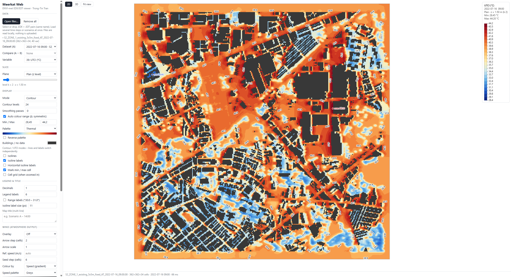
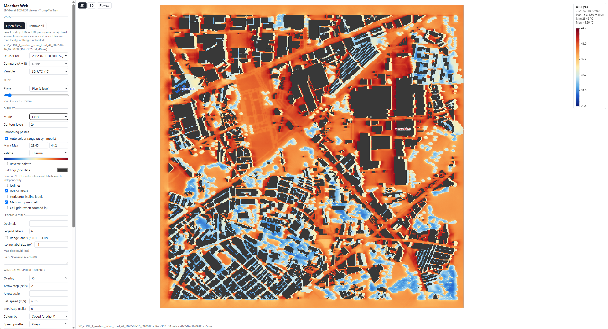
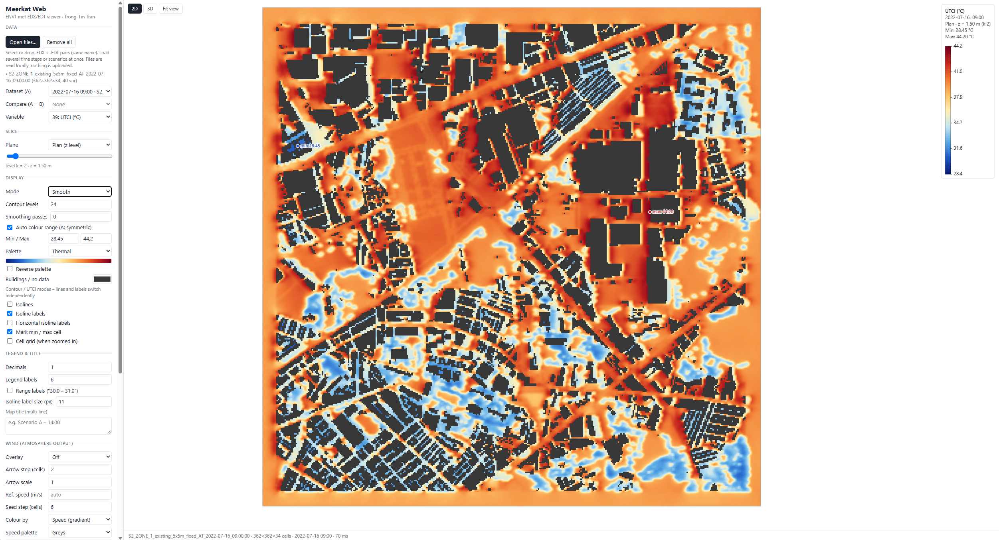
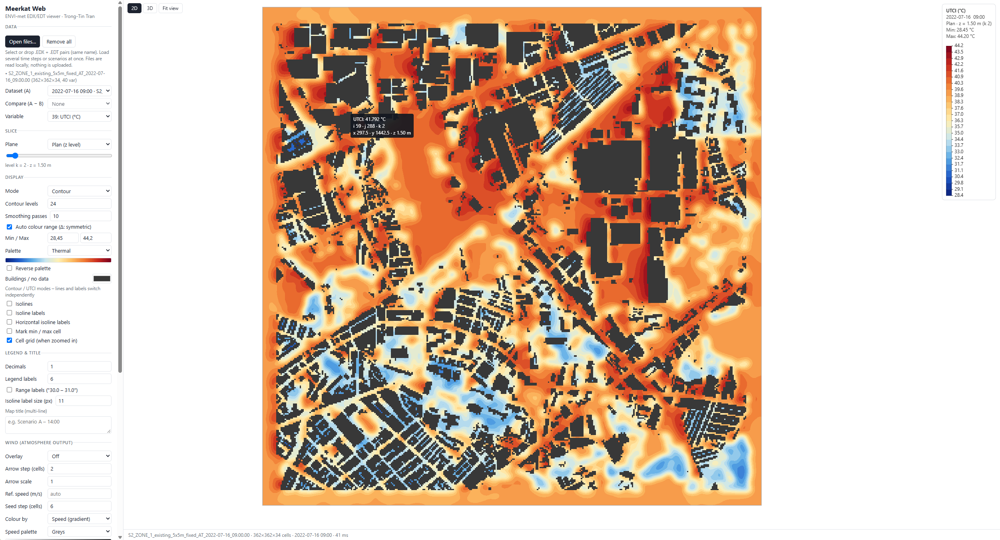
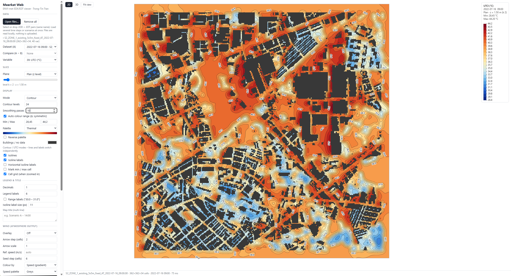
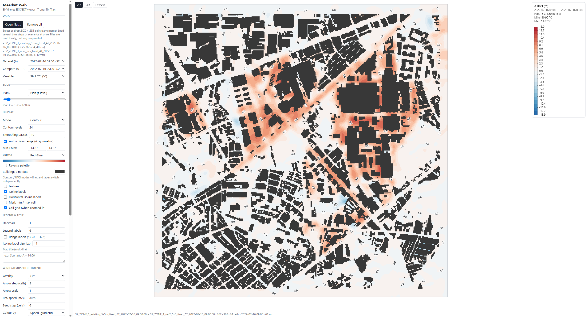
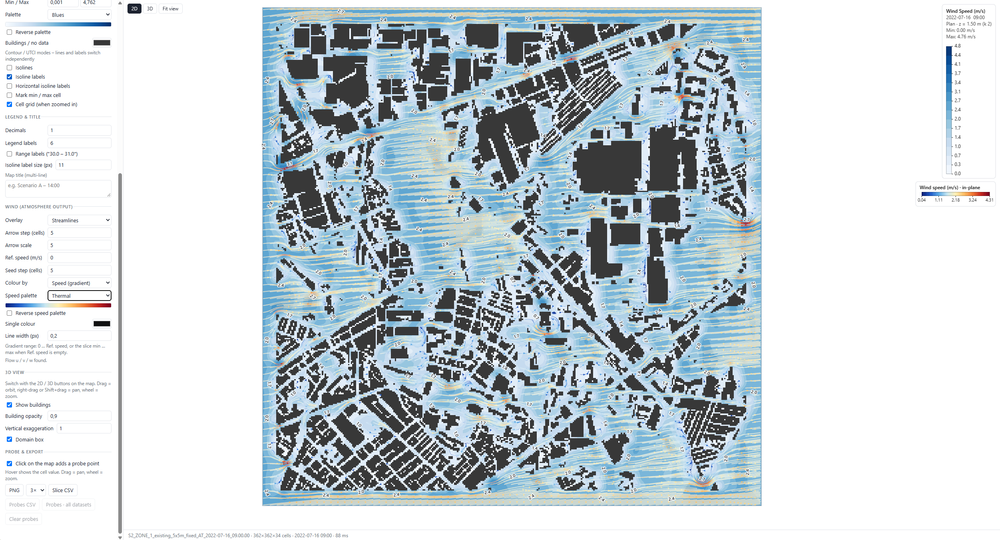
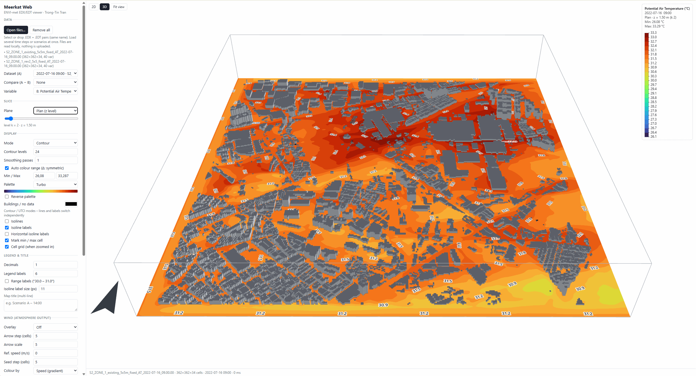
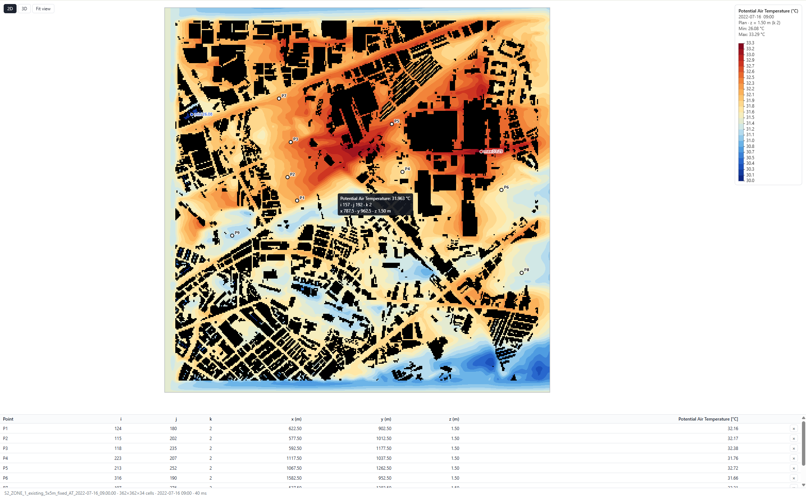

# Meerkat

**Fast visualisation of ENVI-met results – in Grasshopper and in the browser.**

Meerkat reads ENVI-met output files (`.EDX` + `.EDT`) and turns them into heatmaps, contour maps, wind arrows, streamlines and point probes. It comes in two parts:

| | **Meerkat for Grasshopper** | **Meerkat Web** |
|---|---|---|
| Runs in | Rhino 8 / Grasshopper | Any modern browser |
| Install | [Rhino Package Manager](https://rhinopackages.github.io/package/Meerkat) | Nothing – [open the app](https://trongtintr.github.io/Meerkat/) |
| Best for | Linking results to design geometry, baking, parametric studies | Quick viewing, comparing scenarios, sharing with people without Rhino |

<p align="center">
  
</p>

---

## Meerkat for Grasshopper

### Install

**Package Manager (recommended)**

1. In Rhino 8, run the command `PackageManager`.
2. Search for **Meerkat**. The current release is a beta, so tick **Include pre-releases**.
3. Click **Install** and restart Rhino.

Package page: **https://rhinopackages.github.io/package/Meerkat**

**Manual install from this repository**

Download the `.yak` file from [`grasshopper/release`](grasshopper/release) and install it with the Yak CLI that ships with Rhino 8:

```bat
"C:\Program Files\Rhino 8\System\Yak.exe" install meerkat-0.1.3-beta+20587-rh8-any.yak
```

The components appear on the **Meerkat** tab in Grasshopper.

### Components

| Group | Component | What it does | Source |
|---|---|---|---|
| 1 · Read | **EDX_Reader** | Reads one variable of an EDX/EDT file on a plan (z) or vertical section (x / y) as a grid mesh, with date, time, unit, min / max, legend title and a building / no-data mask. | [`edx_reader.py`](grasshopper/scripts/edx_reader.py) |
| 2 · Visualise | **Heatmap** | Fast heatmap or contour map (cells, smooth, contour + isolines, isoline and peak labels, legend, titles). Replaces LB Spatial Heatmap for ENVI-met data. | [`heatmap.py`](grasshopper/scripts/heatmap.py) |
| 2 · Visualise | **Color palette** | Ready-made gradients (thermal comfort, wind speed, diverging …) or a custom gradient for Heatmap and Streamline colors. | [`color_palette.py`](grasshopper/scripts/color_palette.py) |
| 3 · Wind | **Wind_Vectors** | Flat wind arrows from Flow u / v / w on a plan or section. | [`wind_vectors.py`](grasshopper/scripts/wind_vectors.py) |
| 3 · Wind | **Wind_3D** | 3D arrows or streamlines (full 3D or on a slice), from seed points or an automatic grid; data cached between runs. | [`wind_3d.py`](grasshopper/scripts/wind_3d.py) |
| 3 · Wind | **Streamline colors** | Colours streamlines by local wind speed as smooth vertex-coloured tubes, with a speed legend. | [`streamline_colors.py`](grasshopper/scripts/streamline_colors.py) |
| 4 · Analyse | **Point Probe** | Reads result values at any points, with labels, units and an optional CSV table. | [`point_probe.py`](grasshopper/scripts/point_probe.py) |

Requirements: Rhino 8 (Windows / macOS), ENVI-met output files.

### Source code and building the plugin

Each component is a Python script (GhPython, runs in IronPython 2.7 and CPython 3) in [`grasshopper/scripts`](grasshopper/scripts).
The plugin is built with the **Rhino 8 Script Editor**:

1. Open [`grasshopper/project/Meerkat.rhproj`](grasshopper/project) in the Script Editor (`ScriptEditor` command → *File → Open Project*). It uses the component definitions in `Meerkat tools.gh` next to it.
2. Edit a component, then *Build* to create `Meerkat.Components.gha` and the `.yak` package; *Publish* uploads it to the Rhino package server.

The scripts in `grasshopper/scripts` are plain-text copies of the code inside `Meerkat tools.gh`, for reading, diffing and citing. `grasshopper/src` is the C# wrapper generated by the Script Editor at build time and is not edited by hand.

---

## Meerkat Web

**▶ https://trongtintr.github.io/Meerkat/**

A single HTML page – no install, no server. Files are read locally in your browser and are never uploaded.

### Usage

1. Open the app, or download [`index.html`](index.html) and open it in a browser.
2. Drop an `.EDX` file **together with** its `.EDT` file (same name). Several time steps or scenarios can be loaded at once.
3. Choose variable, plane and slice; switch 2D / 3D with the buttons on the map. With several time steps loaded, use the time bar under the map.

The 2D viewer works fully offline. The 3D view loads three.js from cdnjs the first time it is opened.

### Display modes

Cells, smooth, contour (filled bands + isolines) and UTCI thermal-stress classes, on a z level or a YZ / XZ section.

<table>
  <tr>
    <td align="center"><br><sub>Cells</sub></td>
    <td align="center"><br><sub>Smooth</sub></td>
    <td align="center"><br><sub>Contour</sub></td>
  </tr>
</table>

### Time series

Load all time steps of a run at once. Files with the same name apart from the date / time (e.g. `Site_AT_2025-06-21_10.00.01 … _18.00.01`) on the same grid form a series:

- **Time bar** under the map – step back / forward, drag the slider, or **▶ play** (speed and loop adjustable). Keyboard: **← / →** step, **Space** play / pause.
- **Same colour range for all steps** – the automatic colour range is taken over the whole series, so colours stay comparable while playing.
- **Scenario comparison over time** – when B is part of another series with the same time steps, B follows A, so A − B is always shown for the same hour.
- **Value over time** – a chart of the current variable at every probe point and at the section point (✛). Hover for values, click to jump to that time step, export as CSV.

<!-- add a screenshot here: <p align="center"></p> -->

### Sections at the cursor

In plan view, two vertical sections – **XZ** (along x) and **YZ** (along y) – are drawn under the map through the point under the mouse:

- **Follow mouse** – the sections move as you hover the plan; **Fixed** – click the plan to place them (Shift+click adds a probe). Sliders set the column i and row j exactly.
- The dashed line marks the current plan level: drag the **level k** slider and it moves up and down the sections; click a section to set the plan level and position there.
- Same colours, modes, isolines and wind overlay as the plan; vertical scale *fill panel* or 1–10×, optional maximum height; PNG export per section.
- Both sections also appear as vertical planes in the **3D view**.

<!-- add a screenshot here: <p align="center"></p> -->

### Isolines and labels

Lines and value labels switch independently; labels follow the line or stay horizontal.

<p align="center"></p>

### Scenario comparison (A − B)

Difference map between two scenarios or time steps on the same grid, with a symmetric diverging scale.

<p align="center"></p>

### Wind

Arrows or 2D streamlines (arc-length RK2) from an atmosphere output, in a single colour or coloured by speed with their own legend.

<p align="center"></p>

### 3D view

Buildings from the no-data cells (taken from an atmosphere file when one is loaded), the current slice as a textured plane, vertical exaggeration, orbit / pan / zoom.

<p align="center"></p>

### Probe points and export

Click a cell to read every variable at that point. Export probes as CSV for one dataset or for all loaded time steps (long format), the whole slice as CSV, and the map as PNG (2–4×, also from the 3D view).

<p align="center"></p>

### Palettes

24 palettes – Ladybug, Ecotect, Leonardo-style, Viridis, Magma, Inferno, Plasma, Cividis, Turbo, ColorBrewer and diverging sets – plus a custom hex list and reverse.

---

## Repository layout

```
Meerkat/
├── index.html                  Meerkat Web (served by GitHub Pages)
├── docs/images/                screenshots for this README
├── grasshopper/
│   ├── release/                .yak packages (Rhino Package Manager format)
│   ├── package/                Meerkat.Components.gha, manifest.yml, icon.png
│   ├── scripts/                Python source of the 7 components
│   ├── project/                Script Editor project (Meerkat.rhproj + Meerkat tools.gh)
│   └── src/                    C# wrapper generated at build time
├── LICENSE
└── README.md
```

## ENVI-met file format notes

EDT data are float32 little-endian, ordered variable → z → y → x; `-999` marks no data (buildings). Grid size, cell spacing and variable names are read from the EDX header; date and time from the header or, if missing, from the file name.

## Author

Trong-Tin Tran – Department of Civil Engineering, National Taiwan University

## License

MIT © 2026 Trong-Tin Tran

## Third-party notices

Meerkat Web bundles no third-party code. It uses or reproduces the following:

- **three.js** r128 (MIT License) – loaded from cdnjs at runtime for the 3D view only.
- **Colour palettes** – colour stops re-implemented from: matplotlib *viridis, magma, inferno, plasma* (CC0, Stéfan van der Walt & Nathaniel Smith); *cividis* (Nuñez, Anderton & Renslow, 2018); *Turbo* (Google LLC, Apache License 2.0); *ColorBrewer* schemes (Cynthia A. Brewer, Mark Harrower & The Pennsylvania State University, Apache License 2.0); default Ladybug Tools legend colours. The "Leonardo-style" palette is a generic rainbow, not taken from ENVI-met software.

## Disclaimer

Meerkat is an independent project and is not affiliated with, endorsed by or supported by ENVI-met GmbH. ENVI-met is a trademark of its respective owner. Meerkat contains no ENVI-met code or data; it only reads output files produced by the user's own licensed ENVI-met installation.

This project is unrelated to *Meerkat GIS*, an earlier Grasshopper plugin for GIS data by another author.
